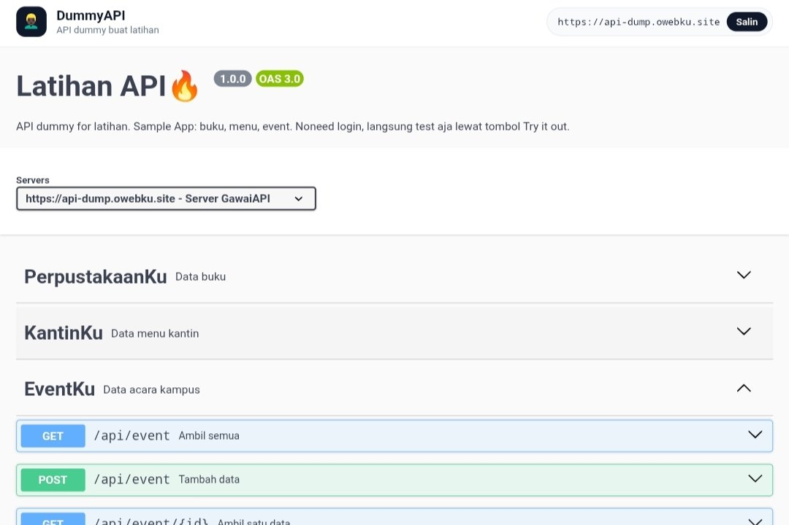

# DummyAPI

API dummy buat latihan. Tiga resource (buku, menu, event), masing-masing 15 data contoh, CRUD lengkap, plus dokumentasi Swagger yang bisa langsung dicoba.



**Live:** https://api-dump.owebku.site — nggak perlu login, langsung pakai.

## Isinya

- 3 resource: PerpustakaanKu (`/api/buku`), KantinKu (`/api/menu`), EventKu (`/api/event`)
- 6 endpoint per resource, total 18 endpoint
- Dokumentasi Swagger UI di halaman utama, ada contoh Dart (Flutter) dan Python di tiap endpoint
- Rate limit token bucket dengan tarif beda per method, biar aman dipakai satu kelas bareng
- Tanpa database dan tanpa library tambahan. Datanya file JSON, servernya murni Node.js bawaan

## Endpoint

| Method | Path | Keterangan |
| --- | --- | --- |
| GET | `/api/buku` | Ambil semua data (bisa `?search=`, `?genre=`) |
| GET | `/api/buku/1` | Ambil satu data |
| POST | `/api/buku` | Tambah data |
| PUT | `/api/buku/1` | Ubah data |
| PATCH | `/api/buku/1` | Ubah sebagian data |
| DELETE | `/api/buku/1` | Hapus data |

Pola yang sama berlaku untuk `/api/menu` dan `/api/event`. Filter tambahan: menu bisa `?kategori=` dan `?tersedia=true`, event bisa `?kategori=`.

Semua respons bentuknya konsisten:

```json
{ "success": true, "data": { } }
```

Kalau error:

```json
{ "success": false, "message": "data buku dengan id 99 tidak ditemukan" }
```

## Rate limit

Satu IP dapat ember 300 token yang terisi ulang 5 token per detik. Tiap request bayar sesuai tarifnya:

| Request | Tarif |
| --- | --- |
| GET satu data | 1 token |
| GET semua data | 2 token |
| POST / PUT / PATCH / DELETE | 10 token |

Kalau token habis, server membalas `429` dengan header `Retry-After`. Ada juga pagar global 600 token (isi ulang 100 per detik) supaya servernya sendiri nggak sesak. Pemakaian normal nggak akan kena limit ini; yang kena cuma request yang ngalir deras terus-terusan, misalnya app yang manggil API di dalam loop.

## Jalanin sendiri

Butuh Node.js saja, nggak ada yang perlu di-install:

```bash
git clone https://github.com/FAHMYZAR/dummy-api.git
cd dummy-api
npm start
```

Server jalan di `http://localhost:3106`. Dokumentasi ada di `/`, spek OpenAPI di `/openapi.json`.

Contoh pakai:

```bash
curl https://api-dump.owebku.site/api/buku
curl https://api-dump.owebku.site/api/menu?kategori=Minuman
curl -X POST https://api-dump.owebku.site/api/event \
  -H 'Content-Type: application/json' \
  -d '{"nama":"Lomba Mobile Legends","deskripsi":"Turnamen antar kelas","kategori":"Lomba","tanggal":"2026-11-02","waktu":"13:00","lokasi":"Aula Kampus","kuota":32,"terdaftar":0,"penyelenggara":"HIMATIK","gambar":"https://example.com/poster.jpg"}'
```

## Struktur

```
server.cjs        server + routing + rate limit, satu file
data/             data contoh per resource (JSON, ikut berubah tiap ada tulisan)
public/           halaman Swagger UI + openapi.json
docs/             screenshot
```

Catatan: datanya dipakai bersama dan bisa berubah sewaktu-waktu karena siapa pun bisa nambah, ngubah, dan ngehapus lewat API. Itu memang tujuannya buat bahan latihan.
